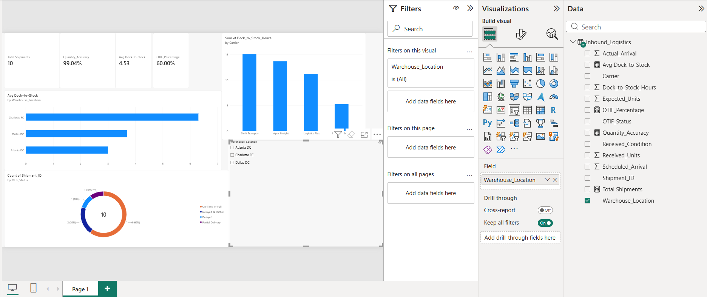

# 🏭 Warehouse Operations & Inbound Fulfillment Performance Dashboard

## 📌 Executive Summary
This project analyzes inbound logistics and distribution center performance across multiple fulfillment facilities. Built in **Power BI**, the dashboard tracks **Dock-to-Stock processing speeds**, **Carrier On-Time In-Full (OTIF) compliance**, and **receiving quantity accuracy** to eliminate receiving bottlenecks and hold freight carriers accountable to SLAs.

---

## 📊 Executive Power BI Dashboard

### Key Performance Highlights:
* **Dock-to-Stock Turnaround:** Identified receiving bottlenecks where processing times exceeded target SLAs (Target: < 4.0 hours).
* **Carrier SLA Tracking:** Evaluated freight carriers on OTIF compliance, identifying high-risk carriers causing dock delays.
* **Inbound Accuracy & Condition:** Tracked damaged goods and short shipments at receiving docks to improve vendor compliance.

---

## 🛠️ Dashboard Architecture & Metrics
* **Total Inbound Volume:** 10 major shipment receipts across 3 primary distribution hubs (Charlotte FC, Atlanta DC, Dallas DC).
* **KPI Measures:**
  * **OTIF Rate (%):** Percentage of shipments delivered on time and 100% complete.
  * **Dock-to-Stock Hours:** Time elapsed from truck arrival at the bay door to inventory placement on warehouse shelves.
  * **Receiving Accuracy (%):** Ratio of actual received units vs. expected purchase order quantities.

---

## 💡 Operational Recommendations
1. **Dock Appointment Scheduling:** Stagger carrier arrival windows for bottlenecked carriers to flatten peak receiving hours.
2. **Standardized Receiving SOPs:** Implement priority staging lanes for high-volume SKUs to reduce Dock-to-Stock cycle time by 25%.
